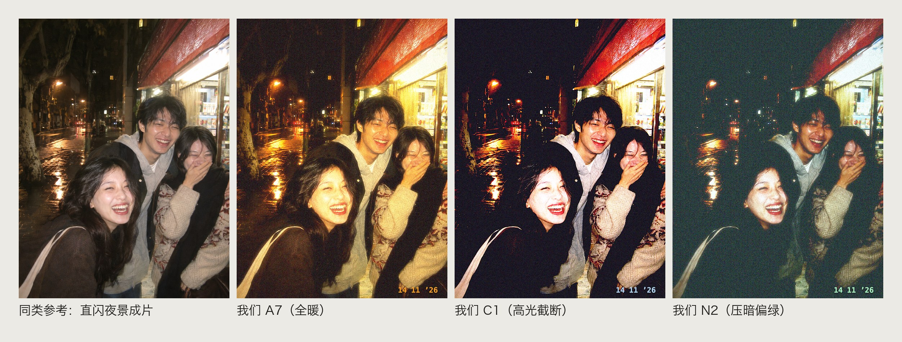
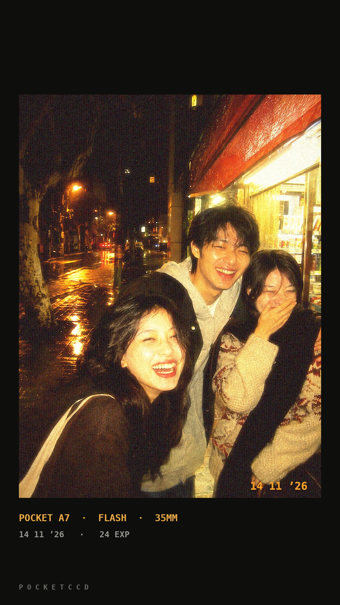

# 分享出去的图/视频长什么样：同类 CCD App 基准 × PocketCCD 输出对照

日期：2026-11-15  
范围：**成片本身**（发到 Instagram / TikTok 的那张图、那条视频）——画幅、边框、日期戳、肤色与高光、颗粒、署名、视频规格；不讨论分享按钮的流程。  
方法：同类 App 官方配方/指南、创作者内容拆解、App Store 页、以及把 `CCDLook` 参数原样套到一张直闪夜景参考图上做的渲染对照（图见 `docs/assets/social-benchmark/`）。  
**重要前提**：渲染对照是"已有直闪暖调的参考图 × 我们的 look"的二次调色，会把色偏放大；真实拍摄请用原始 iPhone 夜景片（8 场景矩阵）复核，结论方向可用、数值不可直接当验收线。

---

## 一、结论

1. **画幅与日期戳我们是对的**：App 里 3:4 / 1:1 / 16:9 在竖拍时分别导出 3:4、1:1、9:16（`CCDLook.swift:431`），橙色等宽日期戳的位置与字号（宽度 3.5%、右下 4.5%）和同类发布形态一致。
2. **肤色和高光是最大偏差**：同类直闪成片是"高光烧白、皮肤中性偏冷、背景保留暖光点"；我们的 A7 把整幅推成暖黄（肤色 B/R 0.51，参考图 0.71），C1 高光截断 11.4%，N2 压暗偏绿。见下方对照板——这是"发出去会不会被赞"的直接差别。
3. **真正缺的是单图 Story 卡**：接触印样已经支持 1080×1920，并已有相机、日期跨度与张数元数据；缺少的是“单张照片 + 机身底栏 + 等宽元数据”的 9:16 发布容器。
4. **视频仍未完全对齐平台规格**：2 秒 Moment 已逐帧套用 CCD look，但保留录制画幅、无视频日期戳；Pocket Day 是 1080×1920，并已有相机与时间底栏，但没有日期戳或快门/闪白转场。

---

## 二、同类 App 用户发出来的"图"长什么样

按出现频次排：

| 形态 | 画幅 / 规格 | 边框与字 | 典型场景 |
|---|---|---|---|
| A 满幅竖图 + 日期戳 | 3:4 或 4:5，1080 宽 | 无边框，橙色日期戳右下 | 夜里朋友合照、镜子自拍、穿搭 |
| B 黑底格栅（接触印样） | 1:1 或 9:16，3–4 列 | 黑底、等宽标题、每格编号、底部一行元数据 | 一卷/一晚的 dump 封面 |
| C 9:16 Story 卡 | 1080×1920 | 照片居中 + 机身/纸底 + 品牌字与型号 | Stories、转发接力 |
| D 对比图 | 左右或上下分屏 | 细白线分隔 + 两行小字 | 原相机 vs App、环境光 vs 直闪 |
| E 相机本体/界面特写 | 9:16 或 4:5 | 真实机身或 App 取景器截图 | "2003 年的相机长这样" |
| F 跨屏拼贴 | 长图切成 3–9 格 | 无边框，靠滑动拼合 | IG 轮播的"一图多格"玩法 |

共同点：**只有日期戳是暖色，其余颜色服务肤色**；品牌字几乎都放在边框/底栏，不压在照片上（Dazz 类水印是例外，也因此常年被吐槽）。

## 三、视觉签名：直闪 CCD 的"正确长相"

来自同类官方配方与指南，可直接当调色目标：

- **白平衡由闪光主导**：皮肤接近中性、允许偏冷；背景继续保留钠灯/招牌的暖点。Dazz 的「冷白皮」配方明确要求强制闪光 + EV −0.3～−0.5，靠闪光在鼻梁/额头拉出高光转折（[C96 Ix 配方](http://dazzcam.app/zh/recipes/cold-white-skin-c96-ix/)）。
- **高光烧白但不发黄**：CCD CAM 档位是 ISO 100–200、EV −0.3、低颗粒、强制闪光（[CCD CAM 指南](https://dazzcam.app/en/guides/ccd-cam-y2k-digicam-guide/)）。
- **颗粒细而均匀**，暗部略强；不是胶片大颗粒。
- **中间调略"浑"、暗部不死黑**，高光硬切——这正是手机计算摄影给不了的。
- **距离与角度决定成片**：0.8–1.5 m、脸侧 15°、避开油光死白（同上配方页）。

## 四、我们的输出实测（同一张参考图，套三条 look）

量化（肤色区取自同一人脸区域）：

| 版本 | 肤色 RGB | 肤色饱和 | 高光截断 | 暗部占画面 |
|---|---|---|---|---|
| 同类参考 | (0.56, 0.44, 0.40) | 0.32 | 2.5% | 9.5% |
| 我们 A7 | (0.68, 0.54, 0.35) | **0.50** | **10.0%** | 0.7% |
| 我们 C1 | (0.61, 0.50, 0.48) | 0.34 | **11.4%** | 3.9% |
| 我们 N2 | (0.55, 0.50, 0.45) | 0.32 | 2.8% | 0.0% |

读法：

- **A7**：`temp 4700 / tint +18 / sat 1.12` 把整幅推向暖黄，肤色蓝通道只有红通道的 51%（参考图 71%）。结果像"暖色滤镜"，不是"闪光打在脸上"。暗部占比 0.7% 说明阴影被整体抬亮，失去背景掉黑。
- **C1**：`contrast 1.22 / ev +0.12 / sharpen 0.72` 让高光直接截断到 11.4%，脸发白发硬，像过曝 JPEG 而不是 CCD。
- **N2**：`ev −0.12 / brightness −0.05 / shadowLift −0.18 / vignette 0.46` 压得太狠，肤色被拉灰偏绿，夜里人脸认不出——这类图用户不会发。

（再次说明：这是二次调色，色偏被放大。但方向与同类配方相反是确定的：别人用闪光把皮肤"提亮到中性"，我们用色温把整幅"推暖"。）

## 五、逐项对照

| 输出项 | 同类 | 我们 | 判断 |
|---|---|---|---|
| 画幅 | 3:4 / 4:5 / 9:16 | 3:4、1:1、9:16（标签写 16:9） | 可用；标签与方向不符，建议显示实际比例 |
| 日期戳 | 橙色等宽右下 | 橙色等宽右下，3.5% 宽 | 一致 |
| 肤色/白平衡 | 闪光主导，中性偏冷 | A7 全暖、N2 偏绿 | **偏差最大** |
| 高光 | 烧白但保色相 | C1 硬截断、A7 高光发黄 | **需要修** |
| 暗部 | 掉黑但保留暖光点 | A7 抬亮、N2 死黑 | 需要修 |
| 颗粒 | 细、均匀 | 只加在暗部，幅度偏大 | 需要修 |
| 边框/署名 | 多在边框/底栏 | 单张照片无品牌角标；接触印样有 POCKET ROLL 标题 | 可增加可选发布版式，不应污染原图 |
| 接触印样 | 黑底 + 元数据行 | 黑底 + 编号；顶部已有相机、日期跨度、张数 | 已具备，位置可再评审 |
| Story 卡 | 9:16 单张照片+底栏 | 已有 9:16 接触印样，但无单图 Story 卡 | 缺单图容器 |
| 视频 | 9:16、带颗粒/日期戳 | Moment 已套 look 但保留录制画幅；Pocket Day 1080×1920 有相机/时间、无日期戳 | 部分对齐 |

## 六、优化（改输出，不改流程）

### P0-1 闪光帧用"闪光白平衡"，而不是整体推暖

真机行为依据：卡片机在闪光触发时 AWB 会向中性偏移。做法：在 `CCDLook.render` 增加 `flashFired` 分支，对 `.flashParty/.flashPair/.flashSequence` 的闪光帧把 `inputTargetNeutral` 从 4700/7200/8200 收敛到 **6000–6300、tint 6–10**，同时 `saturation ×0.94`、`vignette ×0.8`。环境光帧（ambient）保持不变——这样"同一次拍摄里，闪光那张更白、环境那张更暖"，正是 Flash Pair 想讲的故事。

### P0-2 高光与暗部

- 高光：`whiteClamp` 提到 0.995 以上，改用 S 曲线肩部而不是硬切；`CISharpenLuminance` 在亮度 >0.9 的区域降权（可先用全局降低 C1 的 0.72→0.58）。
- 暗部：A7 的 `shadowLift 0.08` 降到 0.02；N2 的 `shadowLift −0.18` 收到 −0.08、`brightness −0.05` 收到 0，保证夜里人脸可读。
- 颗粒：`grain` 降到 0.035–0.05，并把噪声从"只乘暗部掩膜"改为"暗部 1.0 / 中间调 0.45"的两段权重，接近真机。

### P0-3 9:16 Story 卡（新增导出规格）

1080×1920，照片 3:4 居中（960×1280），上 260 pt / 下 340 pt 安全区；底栏等宽字 `POCKET A7 · FLASH · 35MM` 与 `14 11 ’26 · 24 EXP`；品牌字放最底一行，不压照片。示例：

这同时解决"付费用户没有任何署名"的问题——署名变成版式，不再是惩罚。

### P1 接触印样布局复核

`ContactSheetRenderer` 已在顶部输出 `相机 · 日期跨度 · 张数`。是否移动到底部属于版式选择，不是功能缺口。照片当前使用 aspect-fill；改为 contain 前要先比较混合画幅下的黑边是否比裁切更干扰格栅。

### P1 视频规格

- 2 秒 Moment 可另导一份 **1080×1920 + 日期戳 burn-in** 的竖版；当前临时原片会在套用 CCD look 后删除，如需同时保留原片必须另行设计存储策略。
- Pocket Day 加日期戳与相机名，片尾加 0.5s 黑场。
- 都不加音乐：BGM 由用户自己在 TikTok/IG 里加，版权风险不由我们承担。

### P1 画幅标签

UI 里 4:3 / 16:9 在竖拍时实际输出 3:4 / 9:16。建议按当前方向显示真实比例，避免用户以为拍出来是横的。

## 七、怎么验证（不要只靠感觉）

1. 用 `Research/CompetitiveImagingBenchmark.md` 的 8 场景 ×3 次，对同一场景同时拍 A7/C1/N2 与 Dazz、ProCCD。
2. 为每张图在 ROI CSV 中标记同一块人脸区域，再用 `Research/analyze_samples.swift <folder> <roi.csv>` 同时输出全图和 ROI 的 **B/R、高光截断、暗部占比、颗粒代理值**。ROI 坐标为图片显示方向下、左上角原点的归一化 `x,y,width,height`。目标区间只能在真机同场景对照后确定；文中的 B/R 0.68–0.75、截断 <5%、暗部 6–12% 先作为假设，不是发布硬门槛。
3. 盲测：同一场景两版成片，问"哪张更像 2003 年的数码相机"，≥60% 才算过（沿用 spec 验收线）。
4. 社媒侧只看一个指标：**同一条内容两版封面的 3 秒留存**，不看点赞。

## 八、不做

- 不做贴纸/拼贴/滤镜商店（那是 ProCCD 的路）。
- 不为了"冷白皮"把三台相机调成同一个色（身份会消失）；正确做法是**同一台相机在闪光时换白平衡**。
- 不把品牌字压进照片（除了免费版的角标，且应改为底栏）。
- 不做自动发帖。

## 来源

- [Dazz Cam：冷白皮 C96 Ix 配方（强制闪光、EV −0.5、0.8–1.5m）](http://dazzcam.app/zh/recipes/cold-white-skin-c96-ix/)
- [Dazz Cam：CCD CAM 指南（ISO 100–200、EV −0.3、低颗粒）](https://dazzcam.app/en/guides/ccd-cam-y2k-digicam-guide/)
- [Dazz Cam：CCD digicam 指南（日期戳、硬闪光、中间调）](https://dazzcam.app/guides/ccd-digicam-camera/)
- [ProCCD 商店页（跨屏拼贴、模板）](https://apps.apple.com/us/app/id1616113199)
- [CyberLink：photo dump 张数与尺寸](https://es.cyberlink.com/blog/actualidad/5006/photo-dump)
- [NBC：Instagram Add Yours 模板](https://www.nbcnews.com/tech/tech-news/instagram-add-yours-templates-new-chainmail-rcna156135)
- [三湘都市报：Dazz 抖音 18 亿播放、ProCCD 2.4 亿](http://sxdsb.voc.com.cn/content/31029229)
- 本地渲染脚本与对照图：`docs/assets/social-benchmark/`
