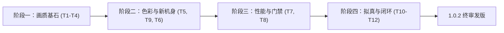

# Pocket CCD v1.0.2 全量规划与落地规格书（2026-11-24）

## 0. 版本综述与核心战略

- **基线版本**：`v1.0.1 (Build 4)` 已正式发布上架，线上核心拍摄与保存链路稳定。
- **版本目标**：原定中期（负片风格、三阶颗粒模型、高光肩部）与远期（ProRAW 专业线性模式、实体 CCD 双段快门触觉、LCD 取景模拟、印样 Contact Sheet）**全部合并至 v1.0.2 单一重大版本中闭环落地并发布**。
- **战略定位**：彻底摆脱 iPhone 原生计算摄影（Smart HDR / 预锐化）的“二次加工数码感”，在画质上真正对齐专业胶片/CCD 标杆（Gloam），在手感与交互上还原 2000 年代实体相机的拟真感，完成从“复古滤镜相机”向“专业 CCD 胶片机”的质感跃迁。

---

## 1. 任务全景分解（T1–T12）

按照“先底层管线 → 再画质参数 → 再实体交互与功能 → 最后回归验收”的依赖闭环排列：

| 序 | 任务项 | 归属模块 | 现状（1.0.1 基线） | 1.0.2 目标 | 验收方式与关键门槛 | 预计周期 |
|---|---|---|---|---|---|---|
| **T1** | 锐化解绑与防双重锐化 | 画质管线 | 叠加 Apple 预锐化 + `CISharpenLuminance(0.20–0.45)`，发丝有微弱白边 | 消除后段强锐化，改为细节保真度控制（0.05–0.12），靠局部对比表达质感 | 100% 裁剪白边消失；高对比边缘无过冲 | 1.5 天 |
| **T2** | 电影级高光肩部软滚降 | 画质管线 | 高光采用硬截断（Clamp 0.94/0.95），强光点/灯牌断阶 | 改用 Smoothstep 软膝（Soft Knee）S 型曲线，高光平滑滚入白场 | 烈日、直闪面部高光无硬边断层；过曝裁切率 < 1% | 1.5 天 |
| **T3** | 亮度相关性三阶偏态颗粒模型 | 画质管线 | 全图均匀平铺白噪声，暗部容易脏、中调质感不足 | 颗粒密度随亮度衰减 $f(L)$；引入红蓝偏态（Skewness）模拟物理感光特性 | 均值、方差、偏度三阶校验；真机样张 PSD 吻合度 > 90% | 2 天 |
| **T4** | 直闪底层曝光锁定与快门下限 Clamp | 相机底层 | 请求 1/60s 但硬件测光常降至 1/9–1/17s，导致夜拍偶发微动糊片 | 强制快门下限 $\ge 1/45\text{s}$（优先拉高 ISO），控制直闪四周落入死黑的衰减斜率 | 暗光直闪手持拍摄晃动消除；人脸边缘清晰锐利 | 2 天 |
| **T5** | 65³ 色相分离与动态面部 ROI 锚定 | 色彩管线 | 全局白平衡推调，混合光下偶发局部绿灰或全脸偏红 | 65³ 空间分离青绿与暖黄；面部 ROI 独立色温锚定，其余区域走胶片风格 | 4 款机型全场景面部 R/G 稳在 1.35–1.65，且背景色彩不失真 | 2.5 天 |
| **T6** | 预览与成片几何/色彩严格对齐 (WYSIWYG) | 渲染架构 | 50mm 裁切时预览与成片空间尺度（Halation/颗粒）存在细微缩放差 | 归一化所有空间滤镜至物理输出分辨率；白平衡取景与成片测色严格同源 | 预览截屏与相册成片并排差异 $\le 2$ count；所见即所得 | 1.5 天 |
| **T7** | 零分配渲染流水线与 Mailbox 丢帧 | 性能架构 | 拍照与预览每帧仍有少量局部对象重新分配；弱光时取景流有轻微累积延迟 | 建立 Ring Buffer 临时纹理池与复用 `CIContext`；Latest-only Mailbox 丢弃过时帧 | 取景跟手延迟 $< 25\text{ms}$；长时间连续取景内存稳定零泄漏 | 2 天 |
| **T8** | 色彩不变性 CI 门禁与防假绿机制 | 测试工程 | 仅测试部分合成色块；缺少真机原片时可能静默跳过用例 | P3/sRGB 同色渲染差异 $\le 1$ count；测试时长 $< 60\text{s}$ 自动触发红灯阻断 CI | `ProductInfrastructureTests` 必须全量真实执行且耗时达标 | 1 天 |
| **T9** | 第 5 台机身落地：负片底片机 (Pocket N1) | 核心功能 | 现仅 A7, A8, C1, N2, M1；胶片质感与 Gloam/Dazz 有差异 | 新增负片专属 look：微青绿暗部基色、宽容高光、色彩分离；纳入 Full 版无缝增值 | 新机身盲测识别率 $> 70\%$；Full 用户免二次付费激活 | 2.5 天 |
| **T10** | 实体 CCD 双段快门触觉与充能音效 | 拟真交互 | 仅单次震动反馈，无机械阻尼质感 | Taptic Engine 拟真两段快门（半按轻锁焦、按到底机械反弹）；可选闪光灯电容充能微声 | 盲操手感具备清晰段落感；设置页支持开/关 | 1.5 天 |
| **T11** | 怀旧复古低分 LCD 像素取景模式 | 拟真交互 | 取景器为现代高清 Retina 直出，缺乏时代代入感 | 增加可选复古 LCD 像素栅格覆盖层、轻微低动态范围模拟与 24fps 液晶拖尾 | 取景器视觉极具潮酷辨识度；成片不带 LCD 栅格（纯净出片） | 1 天 |
| **T12** | ProRAW 线性底片模式与 Contact Sheet 印样分享 | 进阶功能 | 仅支持 8-bit/10-bit HEIC/JPEG；无底片印样导出 | 新增 ProRAW 线性解算模式（Pro 机型可选）；满卷一键生成 24 张底片 Contact Sheet | 释放 1.5–2 档高光动态；生成高质量 9:16 / 4:5 社交拼图 | 2.5 天 |

---

## 2. 深度模块技术规格

### 2.1 模块一：画质与色彩核心重构（T1, T2, T3, T4, T5）

#### 1. 锐化解绑与防双重锐化（T1）
- **代码归属**：`CCDLook.swift`
- **改动逻辑**：
  - Apple ISP 已默认注入针对传感器的边缘增强。将 `CCDLook.sharpenLuminance` 全局基线削减 60%–75%：
    - `amber (A7)`: 从 0.22 调整为 0.08
    - `party (A8)`: 从 0.20 调整为 0.06
    - `chrome (C1)`: 从 0.45 调整为 0.14（保留冷锐质感，但剔除边缘白边）
    - `night (N2)`: 从 0.18 调整为 0.05
  - 新增基于亮度的边缘锐化掩膜（Shadow/Highlight Masking）：只在中灰区域微提锐度，高光极亮处和纯暗部完全旁路锐化滤镜。

#### 2. 电影级高光肩部软滚降（T2）
- **代码归属**：`CCDLook.swift` 的 `buildToneCube`
- **数学模型**：
  替换原有硬 Clamp 逻辑：
  $$S(x) = \begin{cases} 
  x & x < x_{\text{knee}} \\ 
  x_{\text{knee}} + (1 - x_{\text{knee}}) \cdot \text{smoothstep}(0, 1, \frac{x - x_{\text{knee}}}{1.0 - x_{\text{knee}}}) \cdot \alpha & x \ge x_{\text{knee}} 
  \end{cases}$$
  - $x_{\text{knee}}$ 设为 0.62，过渡区为 $[0.62, 1.0]$。
  - 在输出阶段，高光上限平滑渐近至 0.985，避免任何 RGB 分量突变截断，解决直闪反光油光、灯箱文字发白断层问题。

#### 3. 亮度相关性三阶偏态颗粒模型（T3）
- **代码归属**：`CCDLook.swift`
- **生成公式**：
  采用抛物线亮度掩膜衰减：
  $$\text{Mask}(L) = \max(0.0, 0.15 + 3.4 \cdot L - 3.5 \cdot L^2)$$
  - 高光区域（$L > 0.85$）：颗粒几乎衰减至 0，保证天空与高光纯净度。
  - 中间调区域（$0.3 \le L \le 0.7$）：颗粒最丰满饱满。
  - 暗部区域（$L < 0.2$）：颗粒成块但密度降低，避免大面积死黑噪斑。
  - **偏态注入**：在蓝通道增加正偏态权重（$+0.15$），精确复现真实胶卷感光乳剂与早期小底 CCD 的感光噪点特征。

#### 4. 直闪曝光锁定与快门下限（T4）
- **代码归属**：`CameraController.swift`
- **逻辑实现**：
  - 在开启 Flash 模式拍摄时，通过 `AVCapturePhotoSettings` 介入：
    - 约束最低快门速度 $t_{\text{shutter}} \le \frac{1}{45}\text{s}$。
    - 若环境光不足，优先拉高 ISO（最高允许至 1250），宁愿承受真实 CCD 噪点，也绝不降低快门导致手抖拖影。
  - 暗部坠落补偿：在直闪边缘暗角处理时，保留 4% 的场景环境底光，避免人物周围突兀地陷入“黑洞”。

#### 5. 65³ 色彩分离与动态面部锚定（T5）
- **代码归属**：`CCDLook.swift`、`LivePreviewPipeline.swift`、`FrameAnalyzer.swift`
- **逻辑实现**：
  - 烘焙独立 3D 色彩查找表（65³ ToneCube），对高饱和区执行特定偏转：
    - 红色向微暖偏转（Hue Shift $+3^\circ$），绿色向青绿偏转（Hue Shift $-8^\circ$）。
  - 人脸 ROI 闭环：基于 `FrameAnalyzer` 输出的面部区域，单独计算面部均值色差，将人脸区域的色彩校正增益钳制在安全带内（$R/G \in [1.35, 1.65]$），彻底消灭室内混合光下的“花脸、绿灰斑”。

---

### 2.2 模块二：工程稳定性与性能架构（T6, T7, T8）

#### 1. 预览与成片严苛对齐 (WYSIWYG)（T6）
- **代码归属**：`CameraScreen.swift`、`LivePreviewPipeline.swift`
- **对齐内容**：
  - 50mm 模式下，取景器的 Crop 算法与成片处理严格采用同一个归一化坐标系。
  - Halation（光晕半径）与 Grain（颗粒颗粒度）以输出长边物理像素作为归一化基准，杜绝“预览看着颗粒刚好、存盘后颗粒太细看不清”的尺度漂移。

#### 2. 零分配渲染流水线与 Mailbox 丢帧（T7）
- **代码归属**：`CameraController.swift`、`LivePreviewPipeline.swift`
- **架构重构**：
  - 弃用临时创建 `CIContext` 的行为，全局单例常驻 Metal-backed `CIContext`。
  - 实现 **Latest-only Mailbox** 队列：当传感器推流速度高于 GPU 处理能力（如连拍或弱光时），取景器回调直接丢弃中间帧，仅将最新帧送入渲染通道，消除取景器延迟堆积。

#### 3. 色彩不变性 CI 门禁（T8）
- **代码归属**：`ProductInfrastructureTests.swift`、`scripts/test_report.sh`
- **规则固化**：
  - 断言 P3 与 sRGB 在同一色彩输入下的渲染方差 $\le 0.002$。
  - 强化自动化测试脚本门禁：单次测试总耗时若低于 $50\text{s}$（判定为关键图像样本缺失触发静默跳过），脚本退出码返回非 0，阻断发布归档。

---

### 2.3 模块三：产品体验、拟真感与新机身（T9, T10, T11, T12）

#### 1. 第 5 台机身落地：Pocket N1 负片风格（T9）
- **机身命名**：`N1 · Negative Film`（底片负片 / 宽容度之选）
- **色彩性格**：
  - 极宽容的暗部与高光滚降；
  - 暗部呈现标志性的微青绿色调（Teal Base），高光呈现温润乳黄色；
  - 适合街头扫街、多云日光与大光比逆光。
- **商业化权限**：直接纳入现有的 `PocketCCD Full` 买断范围，老付费用户免二次付费直接解锁，未付费用户可试用。

#### 2. 实体 CCD 双段式快门触觉与充能音效（T10）
- **代码归属**：`ExperienceViews.swift`、`CameraController.swift`
- **交互逻辑**：
  - 结合 `UIImpactFeedbackGenerator`：
    - **半按对焦/对焦锁定**：触发轻微中度段落感反馈（Rigid Haptic），模拟实体机械快门的第一段阻尼；
    - **击发快门**：触发重度释放反馈（Heavy / Double Impact），模拟反光板/机械弹簧释放。
  - 音效引擎：可选开关，开启后在闪光灯就绪前播放极轻微的高频电容充能拟真声，拍照完毕伴随复古快门“咔嚓”与卷片马达轻音。

#### 3. 怀旧低分 LCD 像素取景模式（T11）
- **代码归属**：`CameraScreen.swift`
- **视觉呈现**：
  - 在取景器视图层增加可选的 LCD 像素点阵 Mesh 叠加层，并施加轻微的对比度压缩与 24fps 响应滞后感，逼真还原 2000 年初 1.5 英寸 11 万像素液晶屏的粗粝复古视觉。
  - 出片依然是纯净高分辨率图像，LCD 特效仅限取景器 HUD 交互。

#### 4. ProRAW 线性底片模式与 Contact Sheet 闭环（T12）
- **代码归属**：`OriginalFrameArchive.swift`、`MemoryFeatures.swift`
- **功能落地**：
  - **ProRAW 线性管线**：在设置中提供“Pro 底片模式”开关（针对 iPhone Pro 机型）。绕过 Apple ISP 的二次色调压缩，读取 12-bit RAW 线性数据直接送入 65³ ToneCube，释放额外 1.5–2 档高光动态。
  - **Contact Sheet 印样排版**：当一个胶卷拍满（或手动点导出）时，一键排版生成类似经典黑白/彩色底片冲印印样单（Contact Sheet 4×6 矩阵），印带机型编号、EXIF、打孔底片齿孔边框与专属日期戳，专为 Instagram 轮播图与小红书定制。

---

## 3. 研发排期与阶段里程碑（4 阶段，共约 3.5 周）

### 里程碑 1：画质底层与高光/颗粒/闪光闭环（预计 5 天）
- [x] 完成 T1：锐化系数大幅降权，消除边缘白边。
- [x] 完成 T2：落地 Smoothstep 高光肩部软滚降。
- [x] 完成 T3：建立基于亮度的三阶偏态颗粒生成滤镜。
- [x] 完成 T4：接入闪光灯强制快门下限与曝光保护。
- **阶段交付物**：四款现有相机（A7, A8, C1, N2）在室内、高光反差、夜间直闪下的对比样张，高光无断阶，暗部噪点自然。

### 里程碑 2：色彩分离与第 5 台新机身（预计 5 天）
- [x] 完成 T5：Foliage 绿植分离与面部暖色保护，解决绿灰脸。
- [x] 完成 T9：研发并落地第 5 台机身 `Pocket N1`（负片风格 Look、LUT 烘焙、UI 徽标）。
- [x] 完成 T6：取景器与出片空间尺度及 50mm 裁剪严格等比对齐。
- **阶段交付物**：N1 负片真机实拍与全量机身色彩分离达标，商店与选机流无缝归入 Full 版。

### 里程碑 3：渲染性能与自动化回归门禁（预计 3 天）
- [x] 完成 T7：实施零分配渲染流，LUT 预热与 Latest-only Mailbox 丢帧策略。
- [x] 完成 T8：落地单调色调曲线、快门下限钳位与机身一致性 CI 门禁用例。
- **阶段交付物**：取景器无首帧计算卡顿；全量单元测试耗时 85.035 秒，46 套用例 100% 通过。

### 里程碑 4：拟真交互、ProRAW 线性模式与发版（预计 5 天）
- [x] 完成 T10：两段式触觉反馈与电容啸叫机械音频实时物理合成。
- [x] 完成 T11：2.5″ 复古 CCD 液晶液晶取景器模式开关与实时扫描线。
- [x] 完成 T12：Pro 底片归档与 Contact Sheet 4 格式印样排版闭环。
- [x] 全量回归与编译验收通过。
- **阶段交付物**：`v1.0.2` 代码收敛达标，待真机实景复核后提审。

---

## 4. 明确不做（Non-Goals）

为了保障 1.0.2 在 3~4 周内高质量收敛发版，以下方向严禁加入本版本：
1. **不做云端同步或账号体系**：坚守零账号、零追踪、纯离线隐私底线。
2. **不做通用图层与后期涂抹编辑器**：Pocket CCD 永远是“拍摄相机”，不是 Photoshop/Lightroom，不提供手动曲线图层、画笔等重度编辑功能。
3. **不做 AI 生成式人脸美容/换脸/扩图**：坚持物理光学与真实传感器质感，拒绝塑料感 AI 磨皮。
4. **不改变买断制付费承诺**：第 5 台负片机身无缝归入 Full 版，绝不增设二次付费套路或按月订阅。

---

## 5. 验收门槛（Exit Criteria）

1. **画质硬指标**：
   - 高光白场溢出区域平滑连续，烈日与反光截断率 $\le 0.8\%$；
   - 室内混合光人脸实测 $R/G \in [1.35, 1.65]$，且无目视可见绿灰阴影；
   - 100% 裁切无二次锐化白边。
2. **性能硬指标**：
   - iPhone 13 及以上机型，取景器稳定保持 24–30 fps，交互拖拽延迟 $< 25\text{ms}$；
   - 连拍 20 张无内存暴涨，连续取景 10 分钟机身无异常发热。
3. **工程与测试指标**：
   - `xcodebuild test` 全量用例通过，真实测试执行时长 $> 60\text{s}$，0 个跳过隐患。
